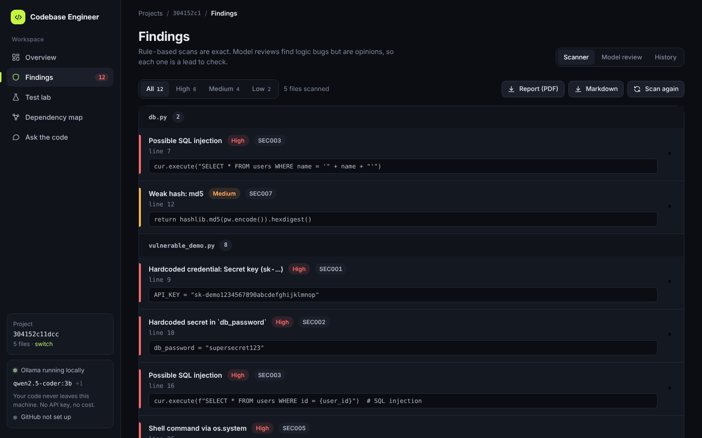
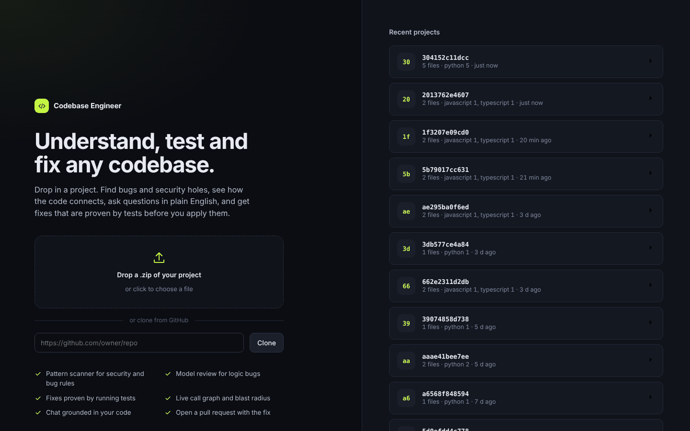
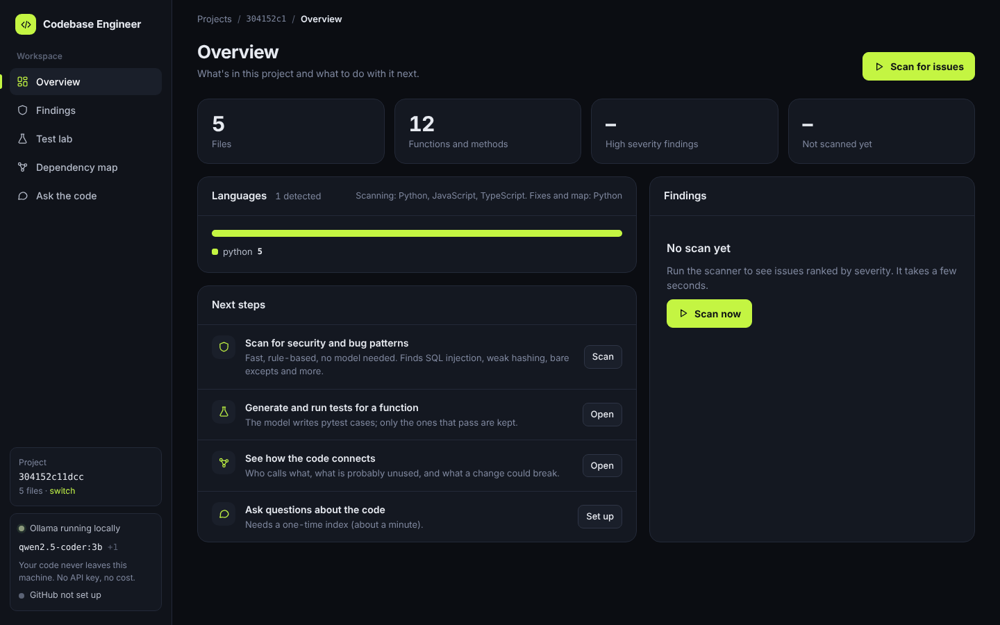
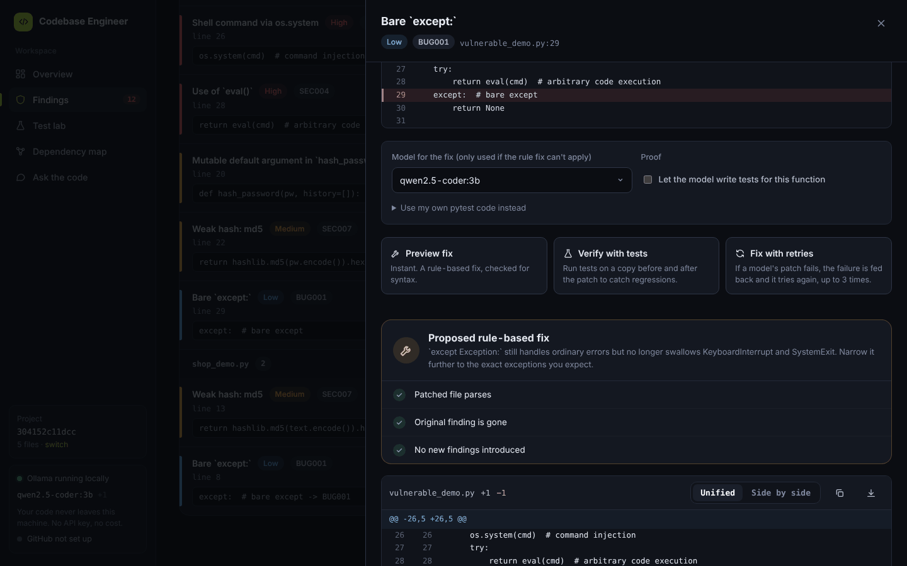
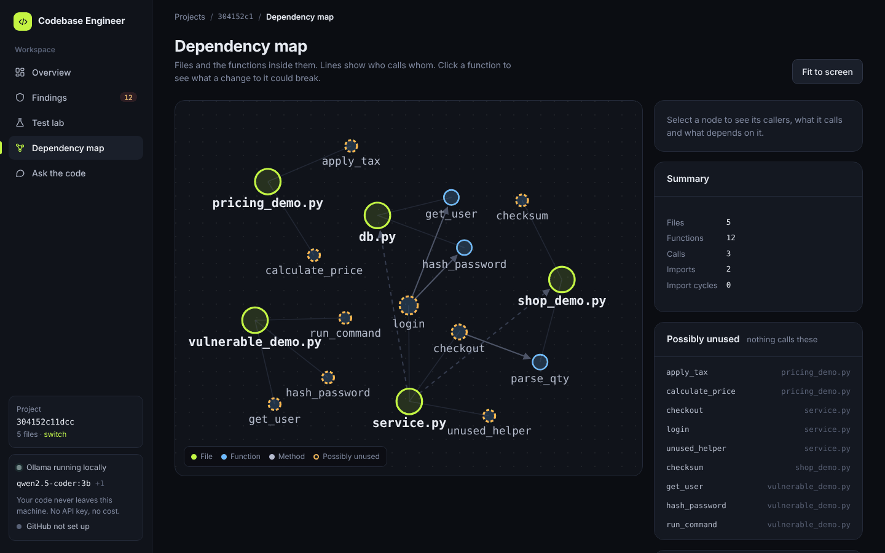
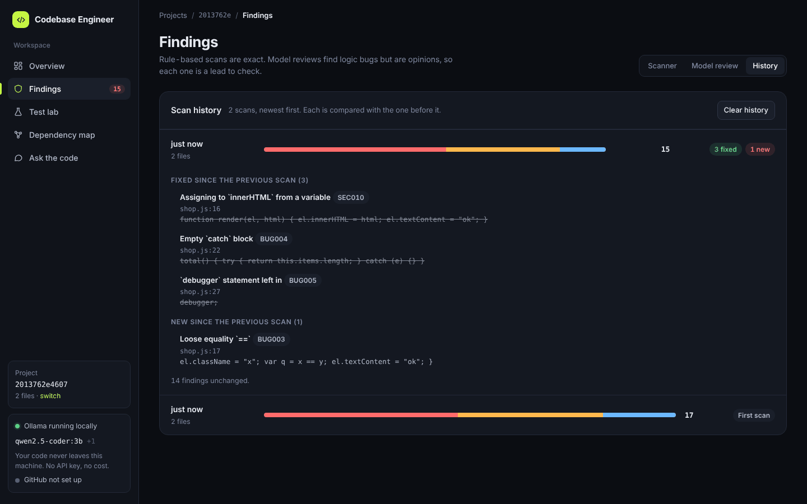
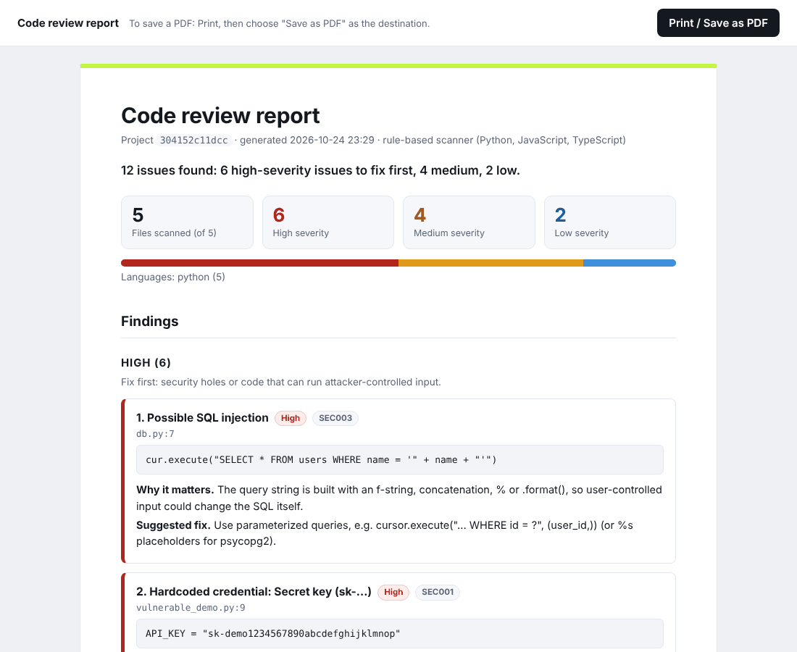

# AI Codebase Engineer

Drop in a project. Find bugs and security holes, see how the code connects, ask questions in plain English, and get fixes that are checked before you apply them.

It runs **entirely on your computer** with free local models ([Ollama](https://ollama.com)). No API key, no cost, and your code never leaves your machine.



## What it does

| | |
|---|---|
| **Scan** | Rule-based scanner for Python (11 rules), JavaScript and TypeScript (12 rules): hardcoded secrets, SQL injection, `eval`, shell injection, weak hashes, XSS sinks, disabled TLS, bare `except`, and more. Exact and free: no model involved. |
| **Fix** | Simple problems get an instant rule-based fix. Harder ones are rewritten by a local model, then **checked**: it must parse, keep the function's name and parameters, remove the finding, and add no new one. You always get a diff to review. Nothing is written to your project. |
| **Verify** (Python) | Runs tests on a copy of your project before and after the patch. A test that passed before and fails after is reported as a regression. Failed model fixes are retried with the reason fed back (up to 3 times). |
| **Dependency map** (Python) | Who calls what, which functions look unused, and the "blast radius" of changing one. |
| **Ask the code** | Chat grounded in code retrieved from your project, with the exact lines cited. |
| **History** | Every scan is saved and compared with the one before: what you fixed, what is new. |
| **Report** | A printable report (save as PDF) or a Markdown file of all findings. |
| **Pull request** | Open a pull request with an approved fix. Dry run first; never pushes to your main branch. |

## Screenshots

| | |
|---|---|
|  |  |
|  |  |
|  |  |

## Quick start (Windows)

You need two things installed first:

1. **Python 3.11 or 3.12** from [python.org](https://www.python.org/downloads/). Tick "Add python.exe to PATH". (Python 3.13 is not supported yet: the tree-sitter packages have no build for it.)
2. **Ollama** from [ollama.com](https://ollama.com), then in a terminal:
   ```
   ollama pull qwen2.5-coder:3b
   ollama pull llama3.2:1b
   ```

Then **double-click `start.bat`**. The first run creates the environment and installs the packages (a few minutes). The app opens at <http://127.0.0.1:8000/ui/>.

Scanning, the report, history and the dependency map work without Ollama. Model fixes, test writing and chat need it.

### Start it by hand instead

```
cd backend
python -m venv venv
.\venv\Scripts\Activate.ps1
pip install -r requirements.txt
uvicorn app.main:app --reload
```

### macOS and Linux

The same commands work with `source venv/bin/activate` instead of the `Activate.ps1` line. The `start.bat` script is Windows only.

## How to use it

1. **Upload** a `.zip` of a project, or paste a GitHub URL to clone (public repos).
2. Open **Findings**. The scan runs automatically.
3. Click a finding, then **Preview fix**. For a model-written fix, use **Fix with retries**.
4. Use **Verify with tests** (Python) to see whether the patch breaks existing behavior.
5. Apply the diff yourself (`git apply fix.patch`), or open a pull request.

### Optional: open pull requests

Create a fine-grained GitHub token limited to **one** repository with Contents and Pull requests set to Read and write, and put it in `backend/.env`:

```
GITHUB_TOKEN=github_pat_...
```

See `backend/.env.example`. Never commit `.env`. Use a throwaway repository the first time and use the dry run before opening a real pull request.

## How it works

```
 browser UI (plain HTML/JS, served by the backend at /ui/)
        |
 FastAPI backend ── jobs + live progress (server-sent events)
        |
        ├─ tree-sitter parsing (Python, JavaScript, TypeScript)
        ├─ scanners (Python ast rules, JS/TS tree-sitter rules)
        ├─ fixer (rule fixes + model rewrite with checks)  ── Ollama (local models)
        ├─ verifier (temporary copy, tests before/after)
        ├─ dependency graph (static call graph, blast radius)
        ├─ index + chat (per-function chunks, local embeddings, Chroma)
        └─ history, report, GitHub pull requests
```

The interactive API documentation is at <http://127.0.0.1:8000/docs>. There is no build step for the interface: it is plain files in `frontend/`.

```
backend/app/
  analysis/       scanners, fixers, dependency graph, report, history
  api/            HTTP routes
  parsing/        tree-sitter parsers
  indexing/       chunking and the vector index
  chat/           retrieval-grounded answers
  verification/   test runs before and after a patch
  integrations/   GitHub pull requests
frontend/         the web interface
ROADMAP.md        what was built, in order, and what is left
```

## Honest limits

- **Small local models make mistakes.** That is why every model fix is checked and shown as a diff. The scanner check proves a pattern is gone, not that the new code is correct. Read the diff.
- **Verification is not sandboxed.** It runs your project's code and the generated tests on your machine, in a temporary copy. Use it on projects you trust.
- **Python gets the most.** Verification, the test lab and the dependency map are Python only. JavaScript and TypeScript get scanning, fixes, the report, history and chat; their fixes are checked by the scanner, not by running tests.
- **The call graph is static and approximate.** Dynamic calls and reflection are invisible to it.
- **Chat sees the best few matches**, so broad questions ("explain the whole app") get partial answers.
- **Single user, local only.** There is no login. Do not expose port 8000 to a network.
- **The Docker files** in this repository have not been tested with the current version. Use the Windows start script or the manual steps above.

## Roadmap

See [ROADMAP.md](ROADMAP.md). Next ideas: run JavaScript tests for verification, chat that follows the call graph, more languages, a sandbox for running tests.

## License

[MIT](LICENSE)
